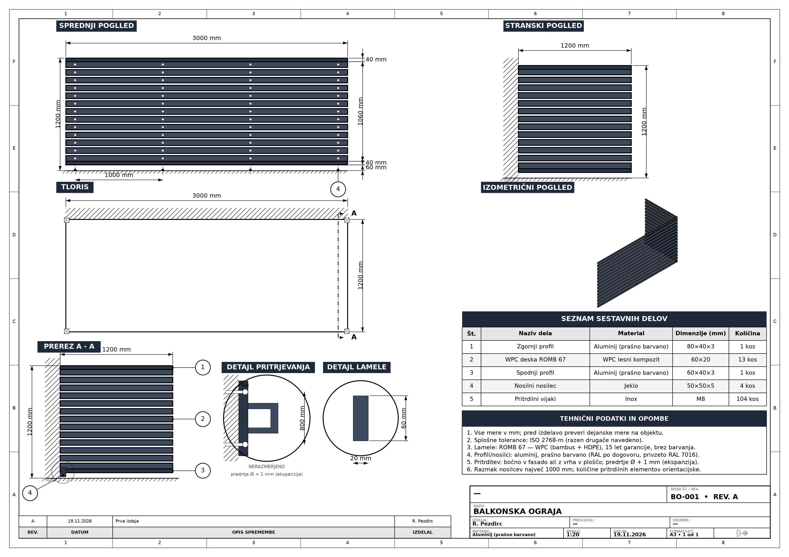

# Generator tehničnih risb — balkonska ograja (WPC lamelle)

[SL] Profesionalni generator tehničnih risb (PDF A3, ISO 5457/7200) in montažnih
listov za balkonske in dvoriščne ograje iz WPC lamel (npr. WoodCore deske ROMB 67,
POLNA DESKA …). Namenjen montažerjem ograj: vpišeš mere s terena, dodaš fotografijo
in dobiš risbo za tisk + montažni list z rezalnim načrtom.

[EN] A lightweight Python tool that generates professional A3 technical drawings
(ISO 5457 frame, ISO 7200 title block) plus a 2-page production document
(installation sheet with cut plan, kerf-aware offcuts, checklist) for WPC
lamella railings — from user-entered dimensions, with an optional photo
measurement assistant.



## Funkcije

- **Tehnična risba A3** — sprednji/stranski pogled, tloris z rezom A–A, prerez,
  detajl pritrjevanja, detajl lamele, izometrični pogled ali fotografija objekta
- **ISO list** — conatna mreža (ISO 5457), glava (ISO 7200), tabela revizij,
  simbol projekcije (prvi kot)
- **Montažni list (stran 2 PDF-a)** — potrebščine, rezalni načrt z ostanki
  (kerf-pozavesten), vizualni rez z izkoristkom, izračun višine, montażni
  koraki s sklici na detajle, kontrola terena, podpis stranke
- **Predračun (stran 3 PDF-a, neobvezno)** — če v konfiguracijo vpišeš `cene:`
  (EUR/m, EUR/kos, delo), se samodejno ustvari orientacijski predračun
- **Kontrola pravilnosti** — pred izvozom program preveri mere in geometrijo;
  pri napaki NE nastane nepopoln PDF
- **Konstrukcijska varnost** — risba izrecno NI statični izračun; nosilnost,
  sidranje in veterno breme preveri usposobljen strokovnjak (na listu)
- **Samodejni izračuni** — lega in količina nosilcev (razmak), št. vijakov,
  št. tovarniških desk/palic iz mer
- **Grafični vmesnik (Tkinter)** — preprosti/napredni način, samodejno
  shranjevanje nastavitev, celozaslonski predogled z povečavo
- **Merjenje s fotografije** (pomožno) — kalibracija na znano dimenzijo
  (npr. 67 mm = širina deske), klik-merjenje, zaznavanje pasov in pik (OpenCV)
- **CLI + konfiguracija YAML** — za ponavljajoče naloge


## Namestitev

Potreben je Python 3.9+ (razvit in testiran na 3.11, Windows):

```bash
python -m pip install matplotlib pyyaml pillow opencv-python
```

## Uporaba

**Grafični vmesnik (priporočeno):**

```bash
python vmesnik.py
```

Vpišeš mere (Enter = privzete), po želji izbereš fotografijo, klikneš
**NARIŠI RISBO**. Nastavitve se samodejno shranijo (`zadnje_nastavitve.yaml`).

**Ukazna vrstica:**

```bash
python risba.py                    # vprašanja v terminalu
python risba.py projekt.yaml       # iz konfiguracije
python risba.py projekt.yaml -o BO-002.pdf
```

**Merjenje s fotografije:**

```bash
python merjenje.py fotografija.jpg
```

## Primer konfiguracije (`projekt.yaml`)

```yaml
ime: BALKONSKA OGRAJA
risba_st: BO-001
izdelal: R. Pezdirc
stranka: Ana Novak               # naročnik (gre v glavo risbe)
objekt: Radovljica, Tržaška 15
mere:
  sirina: 2450                   # dolžina ograje (mm)
  visina: 950                    # višina od tal do vrha (mm)
  globina: 1050                  # stranska dolžina (mm)
  odcep: 50                      # spodnji profil nad tlemi (mm)
  lamela_v: 60                   # višina lamel (mm)
  debelina: 20                   # debelina lamel (mm)
  lamele: 10                     # število lamel
  razmak_nosilcev: 900           # največji razmak nosilcev (mm)
barva: "Antracit"                # ime barve ali #hex
profil: ROMB 67                  # model deske (WoodCore)
dolzina_deske: 5800              # tovarniška dolžina deske (mm)
kerf: 3                          # širina rezila (mm)
foto: poslikava_terena.jpg       # neobvezno — vstavi se na risbo
```

## Struktura projekta

```
risba.py            risalni motor (kote, šrafura, tabele, ISO glava) + predloga "ograda"
vmesnik.py          grafični vmesnik (Tkinter)
merjenje.py         pomožno merjenje s fotografije (kalibracija + zaznavanje)
projekt_primer.yaml primer konfiguracije s komentarji
slike/              primeri izhodov
```

## Kako deluje izračun rezalnega načrta

Iz širine ograje, števila lamel in tovarniške dolžine deske (privzeto 5 800 mm)
skripta izračuna: koliko kosov gre na eno desko (uposteva **kerf** — širino
rezila), koliko desk je potrebnih, ostanek vsake deske in izkoristek. Nosilci se
razporedijo po izbranem največjem razmaku, količina vijakov pa se izračuna iz
števila lamel in nosilcev.

## Znane omejitve

- Samodejno zaznavanje lamel/vijakov na fotografijah je **pomožno** — na
  terenskih posnetkih pod kotom ni zanesljivo; zanesljiva pot je kalibracija +
  klik-merjenje. Odtenek WPC se potrdi s vzorcem proizvajalca (ni RAL).
- Predloga pokriva **prečno** ograjo (vodoravne lamele); pokončna je v pripravi.

## Avtorske pravice

© 2026. Za notranjo uporabo. WPC in znamki proizvajalcev pripadajo njihovim
lastnikom (npr. WoodCore / roksal.com — vir referenčnih specifikacij).
