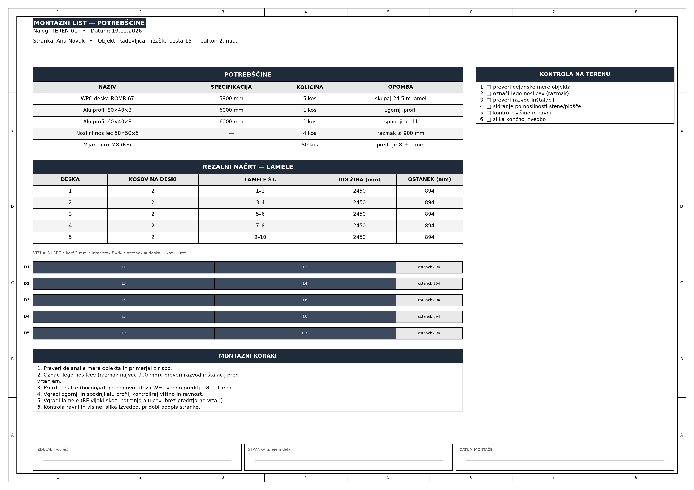

# Generator tehničnih risb — balkonska ograja (WPC lamelle)

[SL] Profesionalni generator tehničnih risb (PDF A3, ISO 5457/7200) in montažnih
listov za balkonske in dvoriščne ograje iz WPC lamel (npr. WoodCore deske ROMB 67,
POLNA DESKA …). Namenjen montažerjem ograj: vpišeš mere s terena, dodaš fotografijo
in dobiš risbo za tisk + montažni list z rezalnim načrtom.

[EN] A lightweight Python tool that generates professional A3 technical drawings
(ISO 5457 frame, ISO 7200 title block) plus a 2-page production document
(installation sheet with cut plan, kerf-aware offcuts, checklist) for WPC
lamella railings — from user-entered dimensions, with an optional photo
measurement assistant.


## Funkcije

- **Tehnična risba A3** — sprednji/stranski pogled, tloris z rezom A–A, prerez,
  detajl pritrjevanja, detajl lamele, izometrični pogled ali fotografija objekta
- **ISO list** — conatna mreža (ISO 5457), glava (ISO 7200), tabela revizij,
  simbol projekcije (prvi kot)
- **Montažni list (stran 2 PDF-a)** — potrebščine, rezalni načrt z ostanki
  (kerf-pozavesten), vizualni rez z izkoristkom, izračun višine, montažni
  koraki s sklici na detajle, kontrola terena, podpis stranke
- **Predračun (priloga PDF-a, neobvezno)** — če v konfiguracijo vpišeš `cene:`
  (EUR/m, EUR/kos, delo), se samodejno ustvari orientacijski predračun;
  če so vse cene 0.00 (PRIMER), je jasno označen kot informativen in
  brez zavajajočih zneskov
- **Kosovnica + nalepke (priloga PDF-a)** — CSV `<nalog>-kosovnica.csv`
  (vsak kos: dolžina, vir — ostanek ali nabava) in nalepke za kose
  (izreži, označi, prilepi); sta prilogi in ne štejeta kot risalna lista
- **Naročilnik** — datoteka `<nalog>-narocilo.txt` s pripravljenim naročilom
  materiala (deske po modelu/barvi/dolžini, profili, pritrdila) za
  copy-paste v e-pošto dobavitelju
- **Razrez čez več tovarniških dolžin** — vpišeš npr. `5800; 4000; 2200` in
  optimizator izbere trakove z najmanj odpada (kerf-pozavestno); nabavne
  deske so štete po dolžinah v potrebščinah, naročilu in predračunu
- **Konfigurabilna pritrdila** — vijak lamela↔profil in vijak
  nosilec/osnova↔podlaga sta prosto besedilo; sledijo jim potrebščine,
  naročilo, detajli, montažni koraki in material (Inox/Pocinkano) iz naziva;
  dobavitelj v naročilu je nastavljiv (privzeto WoodCore)
- **Skladišče ostankov** — naslednji nalog lahko (izrecno vklopljeno)
  najprej porabi ostanke (po barvi in profilu, najdaljši prvi); privzeto je
  uporaba IZKLOPLJENA. Generiranje nikoli samodejno ne spreminja skladišča —
  odpis potrdiš sam (CLI: `--potrosi-ostanke`, GUI: gumb „ODPIŠI OSTANKE”),
  z varnostno kopijo in atomičnim zapisom. Datoteka `ostanki.yaml` je v
  uporabniški podatkovni mapi (`%APPDATA%\TehnicnaRisba`, Linux
  `~/.local/share/TehnicnaRisba`), ki jo lahko prekrižeš z okoljsko
  spremenljivko `TEHNICNA_RISBA_DATA`
- **Kontrola pravilnosti** — pred izvozom program preveri mere in geometrijo;
  pri napaki NE nastane nepopoln PDF
- **Konstrukcijska varnost** — risba izrecno NI statični izračun; nosilnost,
  sidranje in veterno breme preveri usposobljen strokovnjak (na listu)
- **Samodejni izračuni** — lega in količina nosilcev (razmak), št. vijakov,
  št. tovarniških desk/palic iz mer
- **Grafični vmesnik (Tkinter)** — preprosti/napredni način, samodejno
  shranjevanje nastavitev, celozaslonski predogled z povečavo
- **Merjenje s fotografije** (pomožno) — kalibracija na znano dimenzijo
  (npr. 67 mm = širina deske), klik-merjenje, zaznavanje pasov in pik (OpenCV)
- **CLI + konfiguracija YAML** — za ponavljajoče naloge



## Namestitev

Potreben je Python 3.9+ (razvit in testiran na 3.11, Windows):

```bash
python -m pip install matplotlib pyyaml pillow opencv-python
```

## Uporaba

**Grafični vmesnik (priporočeno):**

```bash
python vmesnik.py
```

Vpišeš mere (Enter = privzete), po želji izbereš fotografijo, klikneš
**NARIŠI RISBO**. Nastavitve se samodejno shranijo (`zadnje_nastavitve.yaml`).

**Ukazna vrstica:**

```bash
python risba.py                    # vprašanja v terminalu
python risba.py projekt.yaml       # iz konfiguracije
python risba.py projekt.yaml -o BO-002.pdf
```

**Merjenje s fotografije:**

```bash
python merjenje.py fotografija.jpg
```

## Primer konfiguracije (`projekt.yaml`)

```yaml
ime: BALKONSKA OGRAJA
risba_st: BO-001
izdelal: R. Pezdirc
stranka: Ana Novak               # naročnik (gre v glavo risbe)
objekt: Radovljica, Tržaška 15
mere:
  sirina: 2450                   # dolžina ograje (mm)
  visina: 950                    # višina od tal do vrha (mm)
  globina: 1050                  # stranska dolžina (mm)
  odcep: 50                      # spodnji profil nad tlemi (mm)
  lamela_v: 60                   # višina lamel (mm)
  debelina: 20                   # debelina lamel (mm)
  lamele: 10                     # število lamel
  razmak_nosilcev: 900           # največji razmak nosilcev (mm)
barva: "Antracit"                # ime barve ali #hex
profil: ROMB 67                  # model deske (WoodCore)
dolzina_deske: 5800              # tovarniška dolžina deske (mm)
kerf: 3                          # širina rezila (mm)
foto: poslikava_terena.jpg       # neobvezno — vstavi se na risbo
```

## Struktura projekta

```
risba.py            risalni motor (kote, šrafura, tabele, ISO glava) + obe predlogi
razrez.py           optimizacija razreza (več dolžin, ostanki, kosovnica)
vmesnik.py          grafični vmesnik (Tkinter)
merjenje.py         pomožno merjenje s fotografije (kalibracija + zaznavanje)
api/index.py        spletni generator (Vercel, Flask)
cene.yaml           javni cenik za spletni predračun
TehnicnaRisba.spec  PyInstaller spec za Windows EXE
projekt_primer.yaml primer konfiguracije s komentarji
slike/              primeri izhodov
```

## Kako deluje izračun rezalnega načrta

Enoten model reza (kerf) velja povsod — v validaciji, optimizatorju,
risbah, kosovnici in naročilu: n kosov dolžine `k` iz traku `V` zasede
`n × (k + kerf)`; ostanek je `V − n × (k + kerf)`. Iz širine ograje,
števila lamel in tovarniških dolžin desk (npr. `5800; 4000; 2200`)
optimizator izbere trakove z najmanjšim odpadom na kos, najprej porabi
skladišče ostankov (če je vklopljeno), nato izpiše ostanek vsakega traku
in izkoristek. Če razrez ni popoln (manjkajo kosi), program tega ne
označi kot uspeh, ampak javi napako.

**Konstrukcijska geometrija (dokumentirana odločitev):**

- **pokončna predloga** — stebri so v enakomernih legah, deske potekajo
  po poljih med stebri in so pritrjene na oba sosednja stebra (2 vijaka
  na stik = **4 vijake na desko**); uporabnikova `vrzel` se uporabi
  natanko in se ne prilagaja tiho; če se deske ne prilegajo, je to
  jasna napaka,
- **prečna (ograja)** — vhod je število lamel, vrzel med lamelami se
  izračuna porazdeljeno; razmak nosilcev je največja dovoljena vrednost,
  na risbi in v listih pa se kotira **dejanski** razmak.

## Testi (regresijski)

```bash
python -m pip install -r requirements-dev.txt
python -m pytest tests/ -v
```

Testi (74) v mapi `tests/` pokrivajo vse popravke: življenjski cikel
`PdfPages` in štetje strani s `pypdf`, dolžino kosa za obe predlogi,
validacijo (kerf, dolžine, ročaj/palica), dvojno odštevanje ostankov,
varno skladišče, palice, vijake, pokončno geometrijo, informativni
predračun in krog shranjevanja nastavitev v GUI.

## Izdelava Windows EXE (samostojni program)

```bash
python -m pip install pyinstaller
pyinstaller TehnicnaRisba.spec --noconfirm
# rezultat: dist/TehnicnaRisba.exe (pribl. 177 MB, brez namestitve)
```

Spec vključi risba.py + razrez.py + vmesnik.py; nastavitve se shranijo poleg
EXE (`zadnje_nastavitve.yaml`), ostanki pa v uporabniško podatkovno mapo
(`%APPDATA%\TehnicnaRisba`) — ne več v delovno mapo.

**Poštena izjava o preizkusih:** regresijski testi so bili izvedeni v
razvojnem okolju Windows 11 / Python 3.11.9 / matplotlib 3.11.2; sam
izdelani EXE v tem popravku ni bil ponovno zgrajen ali preizkušen — pred
objavo ga zgradi in preizkusi zgoraj opisanimi koraki.

## Vrata, prehodi, segmenti in DXF (issue #3)

Razširitev podpira vgradnjo vrat in prehodov v **obe** predlogi ograje, z
pravilnimi merami, količinami in izvozom za CAD/CNC.

- **Vrata** (`vrata:` v YAML ali sekcija »VRATA IN PREHODI« v GUI): tipi
  `enokrilna`, `dvokrilna`, `pasja`, `prehodna`; mere, smer odpiranja,
  tečaji, zaklep, ročaj, prečke, diagonala. Geometrija živi v `vrata.py`
  (edini vir resnice) — risba, količine, kosovnica in DXF porabljajo isti
  izračun. Odprtine vplivajo na polnilo (lamele/deske se razrežejo okoli
  njih), razrez, količine in kosovnico — ne le na risbo.
- **Prehodi** (`prehodi:`): odprtina brez kril (prehodna vrata), s svojimi
  količinami (zaključni stebri/profili, sidranje).
- **Več segmentov** (`segmenti:`, YAML shema v2): vsak segment ima lahko
  lastne mere, vrata/prehode in kot (vogal). Stare datoteke (shema v1) se
  samodejno migrirajo v pomnilniku (`migracija.py`), brez izgube podatkov.
- **DXF izvoz** (`--dxf`, gumb »IZVOZI DXF«): R2010, mm 1:1, 9 plasti
  (rez/vrtanje iz OUTLINE/POSTS/HOLES), zaprte konture, kote, naslovni blok.
  **Omejitve:** brez G-code/toolpath, brez kompenzacije orodja/kerfa —
  podrobnosti v `docs/dxf-specifikacija.md`.

Pravila količin (tečaji, vijaki, prečke, diagonala) in odločitve so
dokumentirani v `docs/issue-3-vrata-dxf.md`. **Risba NI statični izračun** —
nosilnost, sidranje in veterno breme preveri usposobljen strokovnjak.

## Znane omejitve

- Samodejno zaznavanje lamel/vijakov na fotografijah je **pomožno** — na
  terenskih posnetkih pod kotom ni zanesljivo; zanesljiva pot je kalibracija +
  klik-merjenje. Odtenek WPC se potrdi z vzorcem proizvajalca (ni RAL).
- Predlogi **prečno** (vodoravne lamele) in **pokončno** (navpične deske na
  stebrih) sta polno podprti.
- Odpis ostankov po rezanju je ročen: gumb „ODPIŠI OSTANKE" v GUI ali
  CLI zastavica `--potrosi-ostanke` (namenoma — potrdiš, da so kose res
  rezali po načrtu).
- Če se kakšen dodaten list (montažni list, predračun, nalepke) ne more
  izrisati, program to jasno javi kot opozorilo (CLI vrne kodo 2, GUI
  pokaže status) — dokument NI tiho prikazan kot popoln.
- **matplotlib >= 3.10.7:** `savefig` po zaprtju `PdfPages` tiho prepise
  PDF v 0 B. Program zato vse strani zapiše v ENEM ciklu `PdfPages`
  (brez risanja po zaprtju) — priporočena različica je v `requirements.txt`.
- Spletni generator (`api/`) na Vercelu NI aktiven — objavljena je statična
  predstavitvena stran (`index.html`); lokalni program je Windows EXE/CLI.

## Avtorske pravice in licenca

Koda je objavljena pod licenco **MIT** (glej `LICENSE`). WPC in znamke
proizvajalcev pripadajo njihovim lastnikom (npr. WoodCore / roksal.com —
vir referenčnih specifikacij)..
